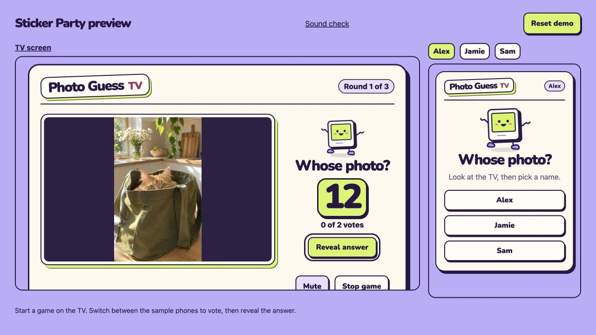
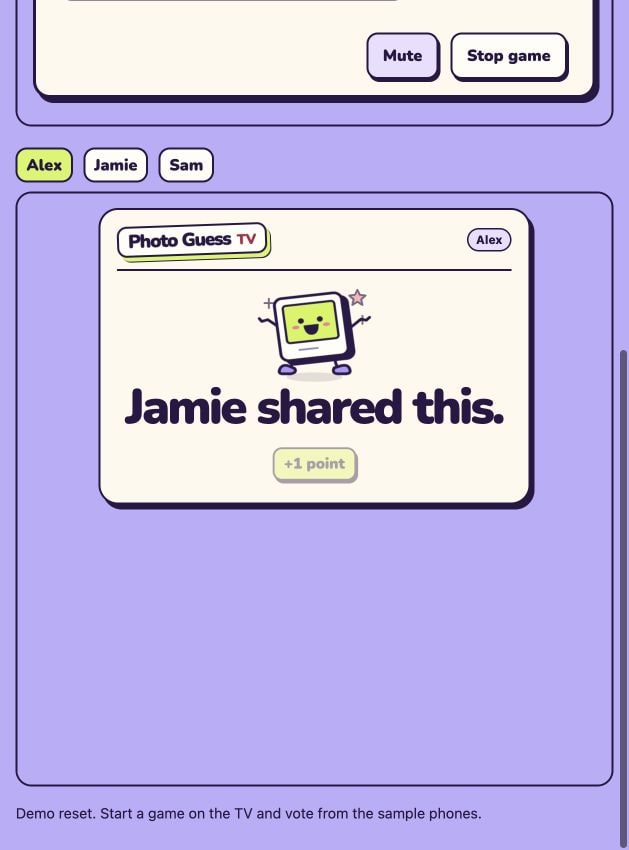
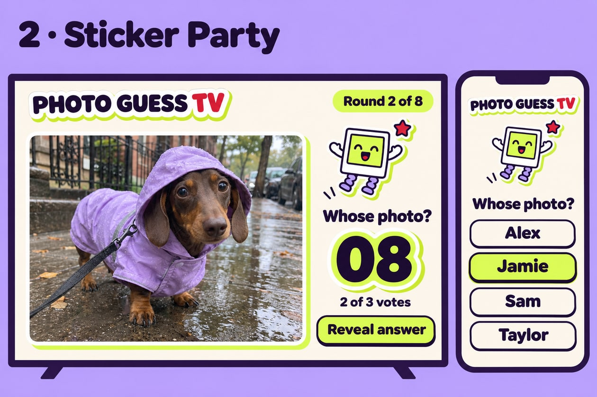

# Photo Guess TV

**Whose camera roll did that come from?** Put a mystery photo on the TV and see which of your friends can claim credit for the world's saddest birthday cake. Photo Guess TV turns the photos everyone already has into a living-room guessing game.

[](https://github.com/SimonStenelid/photo-guess-tv/actions/workflows/ci.yml)
[](LICENSE)

| Make your guess | See who took it |
| --- | --- |
|  |  |

*Actual gameplay from the local preview, using sample photos.*

## How to play

1. Open the game on a TV or a big screen. The host opens a room and puts the join QR code on screen.
2. Everyone scans the code with their phone, picks a name, and shares 1–100 photos. The game starts with at least two players who have shared a photo.
3. Guess who shared each photo before the 15-second countdown ends. The host can reveal early or stop the game at any time.
4. See your result on your phone and follow the leaderboard on the TV. The animated instant-photo mascot and original TV soundtrack come along for the ride. There's a mute button on the TV.

## Get it running

### Host on your Wi-Fi

Install [Node.js 22 or newer](https://nodejs.org/en/download), then run:

```sh
git clone https://github.com/SimonStenelid/photo-guess-tv.git
cd photo-guess-tv
npm ci
npm start
```

Open the TV address printed in the terminal and enter the host code shown there. Use the same Wi-Fi for the TV and phones, and leave the server running while you play. A laptop plugged into the TV works too. For Samsung TV installation, including building the Tizen widget, see the [local and TV guide](docs/local.md).

### Host on Google Cloud Run

Deploy to your own Google Cloud project with Firestore and a private Cloud Storage bucket. The TV and phones connect to your HTTPS service. The app can scale to zero, and game state can survive a Cloud Run restart. See the [Cloud Run guide](docs/cloud-run.md) for setup, access, and cleanup.

### Try the sample game first

After running `npm ci`, run `npm run dev` and open [the local preview](http://127.0.0.1:3100/preview). It puts the TV and a sample phone side by side, with three players and a few photos ready to play. Follow **Sound check** to try the music and effects individually.

## Where your photos go

Local mode keeps game state and photos in the host process’s memory. Restarting the process clears them. Cloud mode saves state and photos to the database and bucket you configure. The app attempts to delete photos as soon as a game ends or is stopped, and the cloud guide sets up automatic cleanup for abandoned games. Anyone with the join link can try to join an open room, so share it with the people you want to play with.

<details>
<summary>See the Sticker Party design concept</summary>



*Design concept artwork.*

</details>

## Contribute

Try a game, [report a bug or suggest an idea](https://github.com/SimonStenelid/photo-guess-tv/issues/new/choose), or see the [contribution guide](CONTRIBUTING.md) for local development. If your group had a good time, a GitHub star helps other hosts find the game.

Photo Guess TV is released under the [MIT License](LICENSE). The bundled [QR code library](vendor/LICENSE) and [Nunito font](public/nunito-OFL.txt) carry their own licenses.
